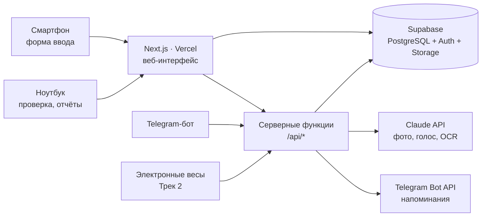
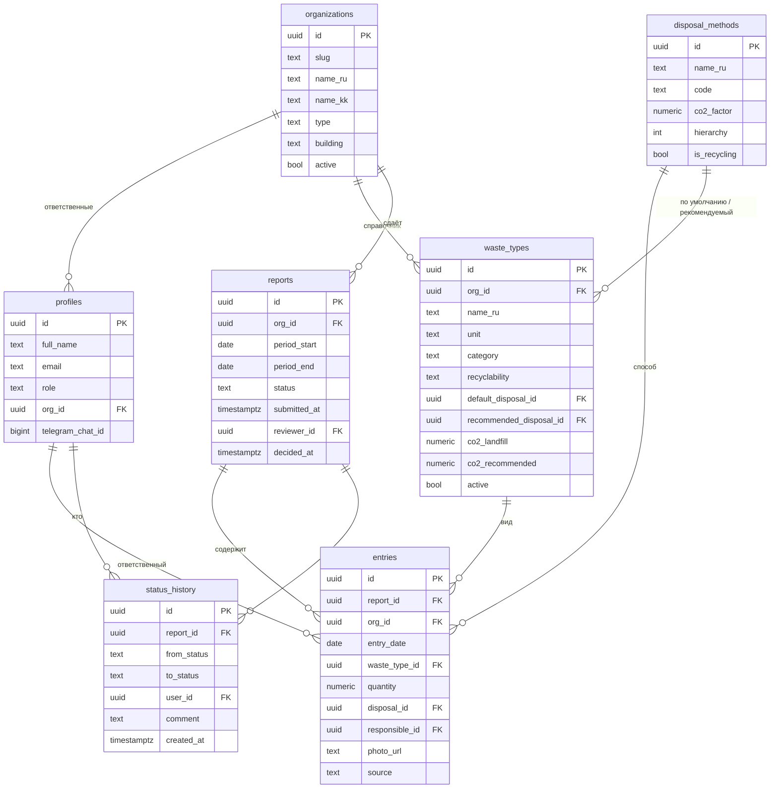

# Sarqyt

*Сарқыт — угощение, которое гости уносят с дастархана: в казахской традиции еду не выбрасывают, а передают дальше.*

Цифровая система управления пищевыми отходами университетского комплекса АО «АТУ».
Хакатон **Smart Food Industries** (12 ноября 2026), Трек 1 — Digital Food Waste Management System for University Campuses.

**Живая версия:** https://zerowaste-atu.vercel.app

Система заменяет бумажные таблицы учёта: ответственный вносит взвешивания со смартфона, проверяющий принимает или возвращает отчёт, принятые данные попадают в единый реестр, сводный отчёт и аналитику с расчётом CO₂-эквивалента.

## Демо-входы

Пароль у всех демо-пользователей один: `Atu2026demo`

| Роль | E-mail | Что видит |
|---|---|---|
| Ответственное лицо — столовая «Искандер» | `iskander@atu.demo` | форма ввода, свои отчёты, аналитика своей организации |
| Ответственное лицо — кофейня «Canella» | `canella@atu.demo` | то же для кофейни |
| Ответственное лицо — ATU INN / ТПП / ТХиПП | `inn@atu.demo`, `tpp@atu.demo`, `thipp@atu.demo` | то же |
| Проверяющий | `reviewer@atu.demo` | очередь отчётов, реестр, сводный отчёт, аналитика |
| Администратор | `admin@atu.demo` | организации, пользователи, справочники, QR, интеграции |
| Руководство | `boss@atu.demo` | реестр, отчёты, аналитика (только просмотр) |

## Сквозной сценарий (раздел 9 ТЗ)

1. Ответственный столовой открывает форму по QR-коду или ссылке и входит.
2. Вносит взвешивания: вид отхода и способ утилизации — из списков, итоги за день и месяц пересчитываются сразу.
3. Добавляет новый вид отхода кнопкой «+ Добавить вид отхода».
4. Отправляет отчёт за месяц — статус «Отправлено».
5. Проверяющий открывает отчёт («На проверке») и возвращает с комментарием — ответственный видит «Возвращено» и комментарий.
6. Ответственный исправляет, отправляет повторно; проверяющий принимает — «Принято», в истории видны все шаги.
7. Данные появляются в едином реестре; работают фильтры по периоду, организации, виду отходов и способу утилизации.
8. Аналитика обновляется: динамика по месяцам, структура по видам, сравнение организаций.
9. Сводный отчёт за квартал по всем организациям скачивается в Excel.
10. В сводном отчёте виден список организаций, не сдавших отчёт за период.

## Что реализовано

**Обязательный состав MVP (раздел 6 ТЗ)** — все 8 пунктов: организации и пользователи с ролями; формы по образцам для пяти организаций с добавлением видов отходов; ввод со смартфона; отправка, проверка и возврат с комментарием; единый реестр с фильтрами; сводный отчёт за месяц / квартал / год с выгрузкой в Excel; аналитика; демо-данные за июль–ноябрь 2026 по всем пяти организациям.

**Дополнительно:**

| Функция | Где |
|---|---|
| Четыре роли вместо двух (администратор, руководство) | раздел «Управление» |
| Интерфейс на казахском и русском | переключатель ҚАЗ / РУС |
| QR-код организации, открывающий её форму | «Управление» → «Организации» → QR |
| Распознавание вида отхода по фото (ИИ), фото прикрепляется к записи | «Ввод» → «Определить по фото» |
| Голосовой ввод: «три кило очистков» | «Ввод» → «Голосом» |
| Импорт существующих таблиц из Excel | «Ввод» → «Импорт Excel / бланка» |
| OCR заполненного бумажного бланка по фото (ИИ) | там же |
| Telegram-бот для быстрого ввода | «Ввод» → «Telegram-бот» |
| Напоминания о сроках в Telegram | «Управление» → «Интеграции» |
| API для электронных весов (стык с Треком 2) | `POST /api/scale` |
| CO₂-эквивалент, потенциал экономии, доля переработки, отклонения, рекомендации | «Аналитика» |
| Сравнение периодов: месяц к месяцу, квартал к кварталу | «Аналитика» |
| Автосохранение черновика формы, предупреждение о дубле, история изменений | «Ввод», «Отчёты» |

## Архитектура



- **Интерфейс** — Next.js 16 (React 19, Tailwind CSS 4), хостинг Vercel.
- **Данные и вход** — Supabase: PostgreSQL, вход по e-mail и паролю (пароли хранятся только в виде хеша), хранилище фото.
- **Разграничение доступа — на сервере**: Row Level Security в PostgreSQL. Ответственное лицо физически не может прочитать записи чужой организации; переходы статусов отчёта выполняются только через функции базы (`submit_report`, `start_review`, `decide_report`), которые проверяют роль и пишут историю.
- **Серверные функции** (`src/app/api`) — ИИ-распознавание, весы, Telegram, создание пользователей. Ключи хранятся только на сервере.

## Модель данных



Правила из ТЗ: итоги за день и месяц вычисляются из записей и нигде не хранятся; единый реестр — это записи отчётов со статусом «принято»; виды отходов с записями нельзя удалить, только деактивировать; принятый отчёт заблокирован от редактирования.

Статусы отчёта: `черновик → отправлено → на проверке → принято` либо `→ возвращено` (комментарий обязателен) `→ отправлено` повторно.

## Расчёт CO₂

Используются справочники Оргкомитета «Справочники для Трека 1: отходы, утилизация, CO₂». Коэффициенты — UK DEFRA / BEIS, *Greenhouse gas reporting: conversion factors 2024*, раздел Waste disposal, кг CO₂-экв на тонну:

| Поток | Полигон (ТБО) | Рекомендуемый способ |
|---|---|---|
| Пищевые отходы | 700,21 | 8,88 (компостирование, анаэробное сбраживание) |
| Бумага и картон | 1 164,39 | 6,41 (переработка) |
| Стекло, ПЭТ, алюминий | 8,88 | 6,41 (переработка) |

Формулы: `CO₂ = масса (т) × коэффициент способа`; `экономия = масса (т) × (коэффициент ТБО − коэффициент нового способа)`. Отработанное масло: 1 л ≈ 0,92 кг.

Допущения справочника: ПЭТ и алюминий считаются как стекло; масло — как пищевые отходы на полигоне и как переработка при сдаче; смешанная упаковка — как картон. Данные британские, для Казахстана ориентировочные.

## Запуск локально

Нужны Node.js 20+ и проект Supabase.

```bash
npm install
```

1. В Supabase → SQL Editor выполнить по очереди `supabase/schema.sql` и `supabase/migration2.sql`.
2. Создать `.env.local`:

```
NEXT_PUBLIC_SUPABASE_URL=https://<проект>.supabase.co
NEXT_PUBLIC_SUPABASE_ANON_KEY=<publishable key>
SUPABASE_SERVICE_ROLE_KEY=<secret key>
ANTHROPIC_API_KEY=<ключ Claude API — для фото, голоса и OCR>
TELEGRAM_BOT_TOKEN=<токен бота — необязательно>
SCALE_API_KEY=<любая строка — ключ для весов>
```

3. Загрузить демо-пользователей и демо-данные (повторный запуск возвращает данные в исходное состояние):

```bash
node --env-file=.env.local scripts/seed.mjs
```

4. Запустить:

```bash
npm run dev
```

Дополнительные скрипты: `scripts/telegram-webhook.mjs <адрес сайта>` — подключить бота; `scripts/scale-demo.mjs` — имитация электронных весов.

## API электронных весов

```
POST /api/scale
x-api-key: <SCALE_API_KEY>
{ "org": "iskander", "waste": "Очистки овощей", "weight": 4.2, "device": "scale-01" }
```

Взвешивание попадает в журнал организации за текущий месяц с пометкой источника `scale`.

## Использованные библиотеки и сервисы

Next.js, React, Tailwind CSS, Supabase (PostgreSQL, Auth, Storage), Recharts (графики), ExcelJS (выгрузка и импорт Excel), qrcode (QR-коды), Anthropic SDK (Claude API), Telegram Bot API, Vercel (хостинг). Шрифты Golos Text и JetBrains Mono (Google Fonts). Все библиотеки с открытыми лицензиями.

## Использование ИИ

- **Claude Code** (Anthropic) — вспомогательный инструмент при написании кода в день хакатона.
- **Claude API** (модель Claude Haiku) — внутри продукта: распознавание вида отхода по фото, разбор голосовых и текстовых записей, OCR бумажного бланка.

Ранее созданных наработок в проекте нет: код написан 12 ноября 2026 года. Данные об организациях, видах отходов и коэффициентах взяты из ТЗ и справочников Оргкомитета. Демо-записи сгенерированы скриптом `scripts/seed.mjs` и не являются реальными данными АТУ.
